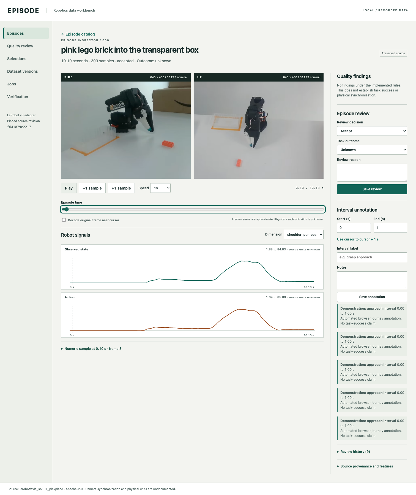

# Episode

A local robotics episode inspector and dataset curation tool. Inspect two camera streams alongside recorded state/action signals, review demonstrations, and freeze reproducible dataset versions that a real consumer can load.



## Implemented

- Pinned LeRobot v3 adapter for 50 pick-and-place episodes, 11,939 samples and two cameras.
- Preserved, SHA-256-verified source assets; traceable VP9 previews; original AV1 frame decoding with PTS checks.
- Durable single-worker jobs, atomic catalog publication, idempotent imports, cancellation and restart recovery.
- Explainable rules and separately labelled fault fixtures. No unexplained quality score.
- Review history, interval annotations, saved criteria, immutable manifests and version comparison.
- Optional local OpenCV diagnostics and Qwen3-VL suggestions with evidence, explicit approval and immutable analysis provenance.
- Whole-episode and exact sequence-family splits, training-only normalization and a standalone manifest consumer.
- Tested desktop/narrow browser journeys, accessibility checks, measured local benchmarks and a read-only replay generator.

The backend is for local use. No robot controller, policy training, cloud deployment or LeRobot-reader compatibility is claimed.

## Run locally

Verified environment: Apple M4, macOS 27.0, Python 3.11.15, Node 22.16.0 and FFmpeg/ffprobe 8.1.2. Install these prerequisites separately if absent. Setup changes project-owned paths only.

```sh
export EPISODE_STORAGE="/Volumes/External Storage/Episode"
python3.11 scripts/setup.py --init-storage
./scripts/episode doctor
./scripts/episode import --limit 3
./scripts/episode worker --once
python3.11 scripts/start.py --port 8765
```

Open `http://127.0.0.1:8765`. Setup keeps environments, package caches, browser binaries, source assets and temporary files in `EPISODE_STORAGE`. It refuses to adopt a nonempty unmarked directory. Reserve at least 2 GiB for setup. The pinned source files total about 82 MiB; shared shards are downloaded even for a three-episode import.

Once the worker is running, `./scripts/episode import --limit 50` queues the full catalog import. `./scripts/episode validate` queues source integrity and validation checks using the same idempotent path. Only one worker may own a storage root. Use another port if 8765 is occupied.

## Local model-assisted analysis

[Analysis setup and workflow](docs/analysis.md) · [Analysis contract](docs/analysis-contract.md) · [Measured analysis results](docs/analysis-results.md)

```sh
python3.11 scripts/setup_analysis.py
"$EPISODE_STORAGE/analysis-venv/bin/python" -B scripts/download_model.py
./scripts/episode analyze --mode diagnostics --all
./scripts/episode analyze --mode vlm --episodes 0 1 2 3 4
```

The existing worker processes these jobs. In the inspector, open Analysis and suggestions to inspect evidence and accept, edit or reject a proposed interval. This uses a separate external environment and a pinned local model. Model suggestions are hypotheses; human semantic accuracy and review-time savings have not been evaluated. No paid inference service is required.

## Curation and consumer

```sh
./scripts/episode catalog --review accepted
./scripts/episode inspect 0
./scripts/episode review 0 accepted --reason "Camera and signal coverage inspected"
./scripts/episode annotate 0 0.0 1.0 approach --note "Interval for follow-up"
./scripts/episode selection "Accepted recordings" --review accepted
./scripts/episode version "Usable source v1"
./scripts/episode verify VERSION_ID
./scripts/episode export VERSION_ID /path/outside/repository/version.json
./scripts/episode compare EARLIER_VERSION_ID LATER_VERSION_ID
```

Three independent episode groups are required for three nonempty splits. Task outcome defaults to unknown. The version command prints its content-hash ID. An exported manifest can be consumed independently of the catalog:

```sh
"$EPISODE_STORAGE/venv/bin/python" -B scripts/consume.py \
  /path/outside/repository/version.json \
  "$EPISODE_STORAGE/sources/f641879e22172be7e8161d5e6c1503c2d2feb657" \
  --split train --windows 1
```

The consumer yields original RGB images, raw and normalized float32 state/action arrays, frame identities and masks. Windows never cross episodes or splits. It drops incomplete tails and rejects windows spanning timestamp gaps.

## Verification and demonstration

```sh
make test
make build
make browser-test
make benchmark
"$EPISODE_STORAGE/venv/bin/python" -B scripts/build_replay.py
python3.11 -m http.server 8767 --bind 127.0.0.1 \
  --directory "$EPISODE_STORAGE/evidence/replay"
```

Browser integration tests require the real import, running API/worker, and generated replay served on port 8767. They append clearly labelled demonstration reviews and versions. Routine CI runs small synthetic backend fixtures and the frontend build without downloading the dataset. See [verification evidence](docs/verification.md) and [benchmarks](docs/benchmarks.md).

The generated replay is read-only and visibly records its source version and generation time. It includes attributed excerpts and saved results, with no simulated job or review writes. No public URL is configured in this repository. See the [demo journey](docs/demo.md).

## Architecture and limitations

FastAPI/Pydantic, SQLite, PyArrow, NumPy, FFmpeg, React and TypeScript. One durable worker owns heavy processing. Large videos are referenced by versions rather than copied. [Architecture and data flow](docs/architecture.md), [canonical model](docs/data-model.md), [timing rules](docs/timing-validation.md), [version semantics](docs/versioning.md), and [operations](docs/operations.md) explain the contracts.

Source metadata does not document physical units, coordinate frames, session IDs or camera synchronization. The dataset card's v2.1 layout is stale; the pinned files use v3.0. Exact sequence checks do not detect every near-duplicate. The custom consumer is verified; a pinned LeRobot reader, policy training and robot task-success evaluation are not. Performance measurements are local and cache-qualified, not distributed-scale claims.

Source recordings: [lerobot/svla_so101_pickplace](https://huggingface.co/datasets/lerobot/svla_so101_pickplace), declared Apache-2.0. See [provenance and attribution](docs/provenance.md), [NOTICE](NOTICE) and [LICENSE](LICENSE). Episode was built with AI assistance; reported behavior and results are backed by executed checks.
