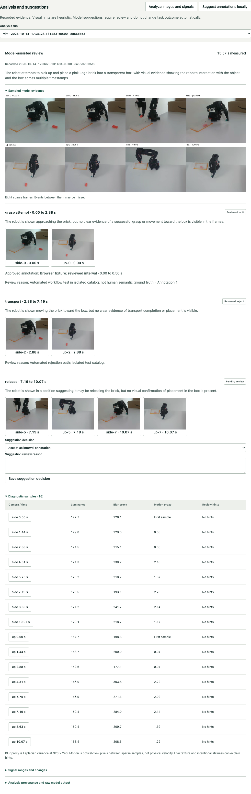

# Executed local analysis results

The extension was evaluated on an Apple M4 with 16 GiB unified memory, macOS 27.0, one worker and external project storage. This report describes data processing and output validity, not model semantic accuracy. No paid inference or cloud service was used.

## Measurements

| Measurement | Observed result |
|---|---:|
| Diagnostic episodes | 50 |
| Diagnostic source frames sampled | 800 |
| Sum of episode diagnostic processing times | 57.98 s |
| Median diagnostic episode processing time | 1.15 s |
| Final VLM pilot episodes | 5 |
| Final schema-valid outputs | 5 of 5 |
| Final pending suggestions | 14 |
| Inference time per episode | 10.69 to 14.00 s |
| Model load time in final worker log | 8.16 s |
| Peak MLX allocator memory | 4.28 GiB |
| Peak process RSS | 1.54 GiB |
| Isolated analysis environment allocated storage | 1.16 GiB |
| Model directory allocated storage | 2.90 GiB |
| Retained analysis derivatives, including earlier pilot runs | 49.85 MiB |

OS cache state was uncontrolled. The model was loaded once and reused within the pilot. Processing sums exclude model load, queueing and worker startup. RSS and MLX allocator memory are different accounting domains; do not sum them as total system RAM. Package caches are shared with other Episode setup work and are additional to the directory sizes above. Temporary downloads were external. The planning allowance was 15 GiB external headroom.

No descriptive image thresholds fired in the 800 sampled frames. That is a threshold result, not evidence that every frame is free of blur, obstruction or other defects. The model saw eight evidence frames per episode, arranged in a contact sheet; diagnostics used sixteen. Sparse samples can miss events. Three to four proposed phases in early outputs did not always follow the prompt's requested count; the parser enforces the declared schema cap of eight suggestions. A missing outcome suggestion is treated as unknown by evaluation.

The first executable pilot had three schema-valid outputs and two outputs missing required fields. Those invalid outputs were retained for inspection and published no suggestions. A subsequent prompt refinement and bounded repair path produced five valid outputs in the final pilot; all five happened to pass on their first attempt. These five episodes are development examples, not an independent semantic test set.

Evidence: [final pilot](../evidence/analysis-pilot-final.json), [benchmark and run identities](../evidence/analysis-benchmark.json), [initial pilot](../evidence/analysis-pilot.json), [model hashes](model-lock.json), [dependency lock](../requirements-analysis.lock). Each catalog analysis additionally retains full prompts, raw attempts, source/derived hashes and its implementation hash. Later UI-only changes do not rewrite those recorded runs.

## Verification and limitations

The optional backend suite passes 33 tests, including malformed evidence, bounds, controlled images, gap exclusion, idempotency, source preservation, interrupted publication, accept/edit/reject transactions, immutable version provenance, actual subprocess cancellation, bounded repair, API boundaries and human-reference requirements. The core environment passes 30 tests with three optional OpenCV tests skipped. One upstream Starlette/AnyIO deprecation warning remains.

Six real-data browser journeys passed in 10.3 seconds, covering model evidence, edited approval and rejection, selection filtering, version freezing, consumer verification, desktop/narrow inspector operation, keyboard controls and recorded replay. Axe reported no violations in the tested WCAG A/AA views. Rendered desktop and narrow screenshots were inspected; manual screen-reader testing was not performed. The browser catalog is isolated from actual reviews and human reference data.

Human semantic accuracy, false-positive rates against human labels, held-out interval accuracy and review-time savings are not evaluated. Evaluation commands return null metrics without references. Episodes 0 through 4 were used for prompt development; reserve 5 through 9 for held-out labeling. No VLA, policy training, segmentation, near-duplicate embedding search or robot control is implemented. Fresh-machine installation, true cold-cache measurements and remote CI were not executed.

## Reproduction

Follow [analysis setup](analysis.md), run the five-episode VLM pilot and full diagnostics, then:

```sh
"$EPISODE_STORAGE/venv/bin/python" -B scripts/benchmark_analysis.py
"$EPISODE_STORAGE/venv/bin/python" -B -m episode.evaluation --output "$EPISODE_STORAGE/evidence/evaluation.json"
"$EPISODE_STORAGE/analysis-venv/bin/python" -B -m pytest -q -p no:cacheprovider --basetemp "$EPISODE_STORAGE/tmp/pytest-analysis"
python3.11 scripts/prepare_analysis_browser.py
EPISODE_STORAGE="$EPISODE_STORAGE/analysis-browser" python3.11 scripts/start.py --port 8768
```

In another shell use EPISODE_URL=http://127.0.0.1:8768, EPISODE_REPLAY_URL for the local replay server, and the isolated storage root when running the browser suite. The preparation script refuses an existing test directory unless --reset is explicitly provided. Reset replaces only the marked test catalog from the real catalog and clears test mutations. Stop the test worker before resetting if it has active work. Do not use the test catalog for real annotations.

[Browser summary](../evidence/analysis-browser-summary.json). Screenshots below show the clearly labelled automated workflow in the isolated test catalog, not human reference annotations.


