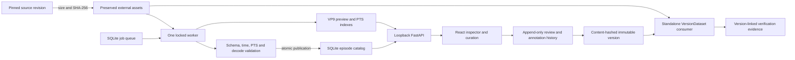

# Architecture and decisions

React/TypeScript renders a loopback FastAPI service. SQLite holds metadata and append-only review history. PyArrow reads selected Parquet columns. FFmpeg/ffprobe perform bounded media operations. One separate worker handles durable jobs; the API does not own background processing. Dataset assets, media derivatives, environments and package caches use configurable external paths.

No DuckDB initially: this 50-episode catalog does not justify a second query engine. No torch in the application environment: consumer verification uses actual numpy batches and original decoded RGB frames. Optional pinned LeRobot-reader testing belongs in an isolated environment. Path allowlists map asset identifiers to configured roots; clients cannot provide SQL or arbitrary filesystem paths. Loopback binding and same-origin mutation checks protect local operations.

Future scale: object storage with immutable keys, transactional catalog server and leased workers could replace local assets/SQLite when measured concurrency or capacity requires it. Costs include distributed transactions, credentials, retries and media delivery. None is implemented or deployed.

## Implemented flow

Source paths come from a tracked source lock, not user-supplied file paths. Each asset is checked against the pinned SHA-256, including metadata and the card. Canonical feature metadata preserves names/dimensions and explicitly carries null units, coordinate frames, control semantics and session identity where undocumented. Versions snapshot this metadata alongside source hashes.

Version creation holds a SQLite write transaction while checking preserved asset hashes, capturing curation state, assigning splits and computing statistics. This intentionally favors a consistent small-data snapshot over concurrent write throughput. The measured catalog latency does not justify adding an analytical query service for this release.

The manifest consumer accepts an exported JSON file and source root. It checks source hashes, independently reads metadata and episode rows, and yields explicit window identities, masks, normalized/raw signals and original decoded images. It does not consult current catalog reviews. Verification records are separate from immutable content so adding a later measurement cannot alter a dataset version.
